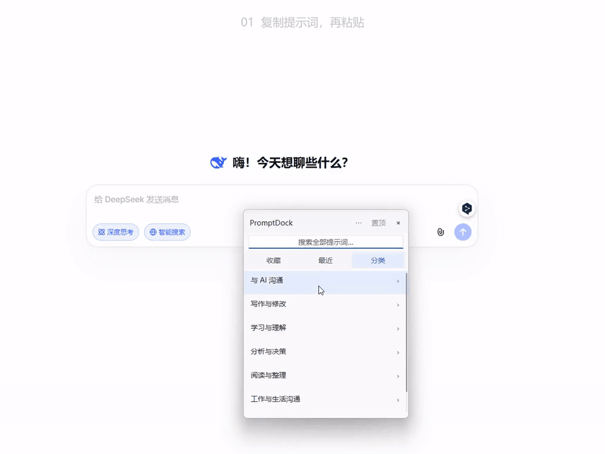

# PromptDock

**好用的提示词，随叫随到。**

一个 Windows 本地提示词工具：按分类或关键词找到完整提示词，编辑、收藏，并把正文安全粘贴回原输入框。

**[下载 Windows 版 v0.2.0](https://github.com/20082123/PromptDock/releases/download/v0.2.0/PromptDock-0.2.0-windows-amd64.zip)** · [所有版本](https://github.com/20082123/PromptDock/releases)

支持 Windows 10／11 x64，解压后运行 `PromptDock.exe`，不需要 Python、.NET、账号或模型 API。请下载 Windows ZIP；GitHub 的 Source code 是给开发者的源码。

约 24 秒循环演示，可直接在本页观看：**复制后粘贴 → 点击插入 → 回车插入**。包含局部放大与按键提示。

录屏使用隔离示例库，未发送消息；按键提示按用户确认的操作后期添加。[高清 MP4（可选）](https://github.com/20082123/PromptDock/releases/download/v0.2.0/PromptDock-demo.mp4) · [录制说明](DEMO_RECORDING.md)

## 开始使用

1. **解压运行** `PromptDock.exe`，程序驻留系统托盘。
2. **在目标输入框按 `Ctrl+Alt+P`**，从分类进入，或直接搜索关键词；收藏和最近方便重复使用。
3. **选择提示词并按 Enter 插入**；右键可以查看全文、复制、收藏和编辑。

插入只粘贴正文，不自动发送。按需修改正文、填入自己的问题或上传文件，最后由您自己发送。如果自动粘贴失败，可回到输入框手动按 `Ctrl+V`。`Ctrl+Enter` 查看详情、`Ctrl+D` 收藏、Esc 返回或隐藏；置顶入口在顶部及菜单内。

## 自己新建提示词

打开托盘菜单的“管理提示词”→“新建”，填写**名称和正文**后保存即可。分类默认“未分类”，标签可选，不需要编辑 JSON。管理窗口可编辑、导入／导出，并展开查看作者、来源和许可。

## 更新、数据与卸载

- **软件更新**：托盘、浮窗“⋯”和管理窗口都有“检查软件更新”。更新窗口可关闭自动检查；有新版时显示版本与摘要，只有点击“更新并重启”才下载。官方发布包从 `20082123/PromptDock` 的稳定 Release 检查更新；无法连接时可从下载页手动获取。早期未配置更新源的本地试用版，需要先手动下载正式版。
- **内置提示词更新**：管理窗口→“检查内置内容更新”→预览→确认；个人修改、收藏、使用记录和删除标记继续保留。它与软件升级分开。
- **数据与备份**：默认位于 `%LOCALAPPDATA%\PromptDock\library.json`。可导出 JSON，或退出后复制整个数据目录。软件升级前自动创建 `backups\pre-update-*\library.json`，备份失败则停止安装。恢复说明见 [UPDATING.md](UPDATING.md)。
- **退出**：右键托盘图标→“退出”，或浮窗“⋯”→“退出 PromptDock”。关闭管理窗口只隐藏窗口。
- **卸载**：退出程序后运行同目录 `Uninstall.exe`，确认后移除程序及随包说明，保留个人库、设置与备份。解压版不写入系统安装记录，不需要管理员权限。

## 限制与反馈

目前支持可写目录中的 Windows x64 解压版。软件未进行代码签名；下载 SHA-256 用于完整性验证，不能替代签名。未验证所有浏览器、聊天软件、输入法、多显示器与不同权限级别的兼容性。遇到问题请记录 Windows 版本、目标软件和复现步骤，通过 [Issues](https://github.com/20082123/PromptDock/issues) 反馈，请勿附带私人提示词或账号信息。

## 内容与许可

自有代码采用 [MIT License](LICENSE)，Copyright (c) 2026 20082123。18 条公开内置提示词（8＋10）保留各自作者、来源、许可、完整声明和整理说明，详见 [第三方声明](THIRD_PARTY_NOTICES.md)。14 条许可待确认候选及相关存档不进入公开源码和发布包。

开发者构建、验证与打包见 [BUILDING.md](BUILDING.md)。
